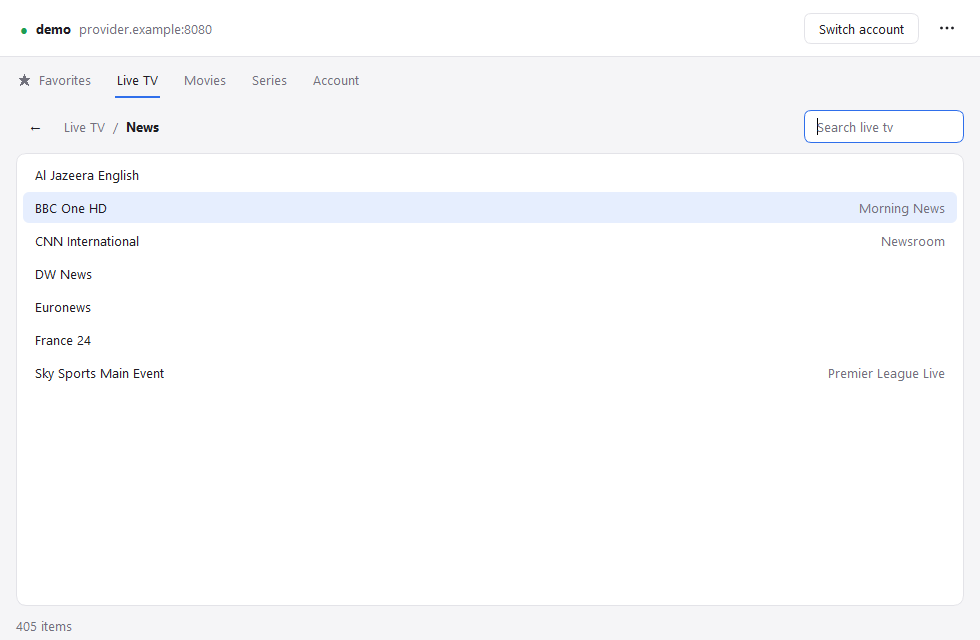
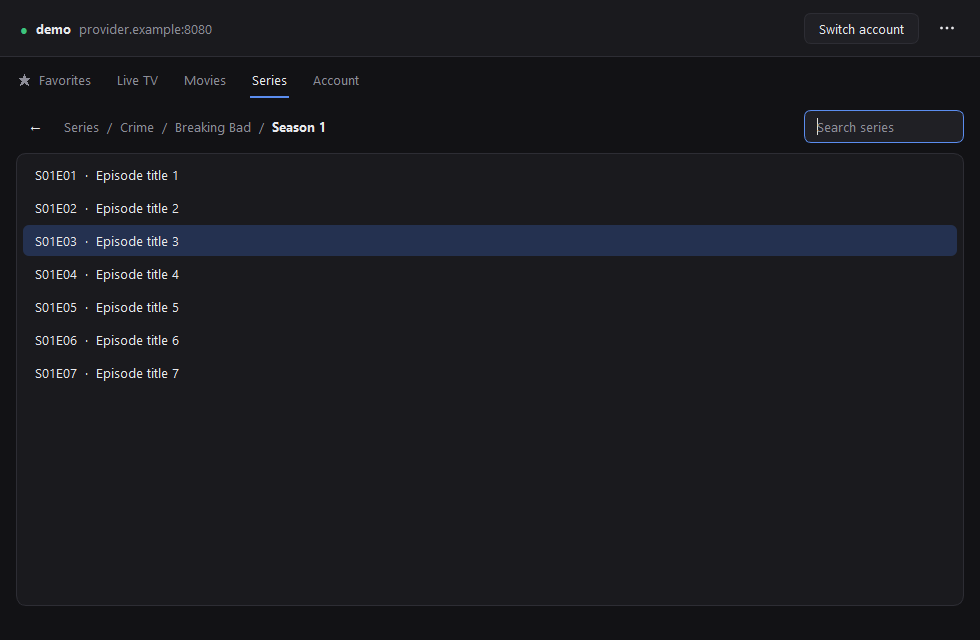

<div align="center">


# Ramuzu IPTV Player

**A fast, minimal desktop player for Xtream Codes and M3U IPTV accounts.**

by **ccarneros**

[](../../releases/latest)




</div>

> [!NOTE]
> Ramuzu IPTV Player is only a player. It does not provide channels, playlists, subscriptions or any content. You need your own legal IPTV subscription.

## Download

Go to **[Releases](../../releases/latest)** and download one of these:

| File | What it is |
| --- | --- |
| `RamuzuIPTVPlayer-Setup-<version>.exe` | Installer. Adds a Start menu entry and an uninstaller. No administrator rights needed. |
| `RamuzuIPTVPlayer-<version>-windows-x64.zip` | Portable version. Unzip it and run `Ramuzu IPTV Player.exe`. |

You don't need Python. To play streams you need a media player: [VLC](https://www.videolan.org/vlc/) is recommended and is detected automatically.

> [!IMPORTANT]
> The app is not code-signed, so the first time you run it Windows SmartScreen may show **"Windows protected your PC"**. Click **More info → Run anyway**.

## Features

- **Live TV, Movies and Series** with breadcrumb navigation and instant search
- **Favorites**: star any channel, movie or series and find it in its own tab, kept separately for each account
- **TV guide (EPG)**: the programme on air next to each channel, with details and what's on next on hover
- **Movie and series info on hover**: poster, synopsis, genre, rating, cast and director
- **Saved accounts** that connect automatically at startup. Passwords are stored in the Windows keychain, never in plain text
- **Light, dark or system theme**, adjustable text size, always on top
- **Lightweight**: all network work runs in the background, so the window never freezes

<div align="center">

&nbsp;

</div>

## How to use

1. Enter the server, username and password, or paste your full M3U link (`http://host:port/get.php?username=…&password=…`) into the server field, then press **Connect**.
2. Double-click or press **Enter** to open a category or play something. **Backspace** goes back.
3. Start typing in any list to search it (`Ctrl+F` also works).
4. Right-click an item or press **Ctrl+D** to add it to **Favorites**. In the Favorites tab, **Delete** removes it.
5. Use **⋯ → Save this account…** so the app connects automatically next time.
6. Everything else is in the **⋯** menu: saved accounts, media player, theme, text size, TV guide and cache.

| Shortcut | Action |
| --- | --- |
| `Enter` / double-click | Open or play |
| `Backspace` | Back |
| `Ctrl+F` | Search |
| `Ctrl+D` | Add to / remove from favorites |
| `Ctrl+O` | Saved accounts |
| `Ctrl+L` | Switch account |

## Privacy and security

- Passwords go to **Windows Credential Manager** (macOS Keychain or Secret Service on Linux), never to a file.
- Settings and favorites are stored in `%APPDATA%\ccarneros\Ramuzu IPTV Player\settings.json`. Image and guide cache: `%LOCALAPPDATA%\ccarneros\Ramuzu IPTV Player\cache`.
- HTTPS certificates are always verified. Data sent by the provider is validated before being passed to the media player.
- Many IPTV providers only support plain HTTP. When that happens the app shows **Not encrypted (HTTP)**, because your credentials travel unencrypted. **⋯ → Send requests with POST** at least keeps them out of URLs and server logs.

## Run from source

Requires Python 3.9 or newer.

```bash
python -m pip install -r requirements.txt
```

```bash
python ramuzu_iptv_player.py
```

On Linux, `bash install.sh --run --desktop` installs the dependencies and adds a menu entry.

## Build the Windows release

```bash
powershell -ExecutionPolicy Bypass -File packaging\build_windows.ps1
```

This produces in `dist\`:

- `Ramuzu IPTV Player\`: the standalone app folder, built with PyInstaller
- `RamuzuIPTVPlayer-<version>-windows-x64.zip`: the portable version
- `RamuzuIPTVPlayer-Setup-<version>.exe`: the installer, only if [Inno Setup 6](https://jrsoftware.org/isdl.php) is installed

## License

Distributed under the [GNU General Public License v2](LICENSE).
